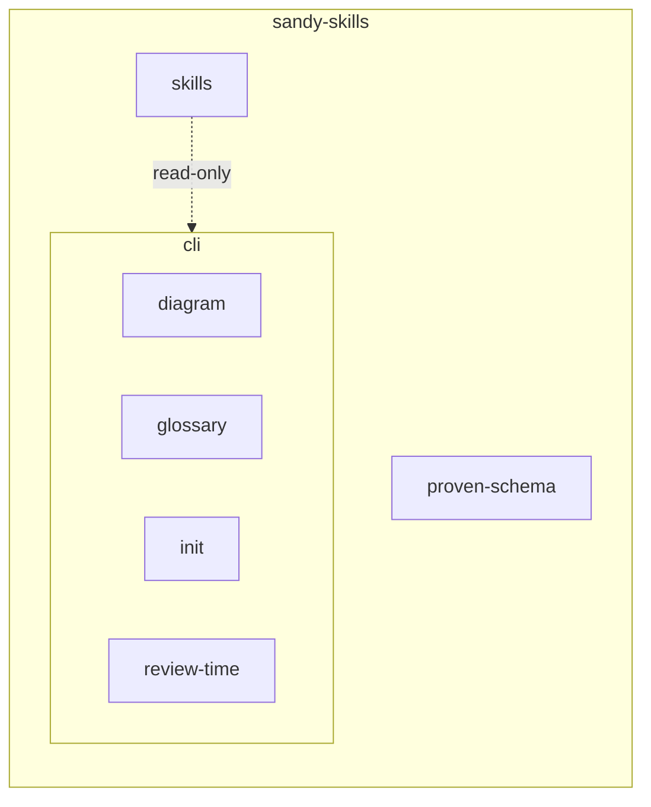

# Diagrams of parts and seams

**Status:** Draft; generated and checked by `sandy-skills`, used on this repo only.

A picture of the system next to the specs helps people find their way, but drawn by hand it drifts from the specs' `Part of` and `Seam to` lines, and nobody notices. So pictures of parts and seams are generated from the specs, never drawn by hand, and the checker fails when one is stale.

## Rules

1. A picture of parts and seams is a marked block, generated by `sandy-skills diagram`. Never edit what is inside it.
2. Put the block in any Markdown file of the repo, where readers look for it: `docs/architecture.md`, `docs/design/`, a part's own doc. Name a part to show that part, what is below it and its neighbours, or `all` for every part:

   ~~~~markdown
   <!-- sandy-skills diagram: all -->
   ```mermaid
   flowchart LR
   …
   ```
   <!-- /sandy-skills diagram -->
   ~~~~

3. After changing specs, run `sandy-skills diagram --write`. It rewrites every block, leaves the rest of each file as it was and lists the files it changed. Commit them with the spec change.
4. `sandy-skills check` reports `stale-diagram` (file and line) for a block that differs from what diagram generates, and `unknown-part` for a block that names no spec. Both are errors, so a stale picture is not releasable. Repos without blocks are unaffected.
5. Hand-written Mermaid stays fine for what is not a part: sequences, data flows within one part, prototypes. Do not draw parts and seams there.

## What the picture shows

A part with parts below it is a subgraph, nested by `Part of`; every other part is a node labelled with its spec's title. Each seam is an edge: solid and labelled `exclusive` for an exclusive seam, dotted and labelled `read-only` for a read-only one, plain otherwise. Proposed parts have a dashed outline, retired parts are grey. Blocks are read outside code fences only, and not under `.git`, `node_modules` or `openspec/changes/archive`. Format of the specs: [spec format](spec-format.md).

## Example

This repo's own parts:

<!-- sandy-skills diagram: all -->

<!-- /sandy-skills diagram -->
